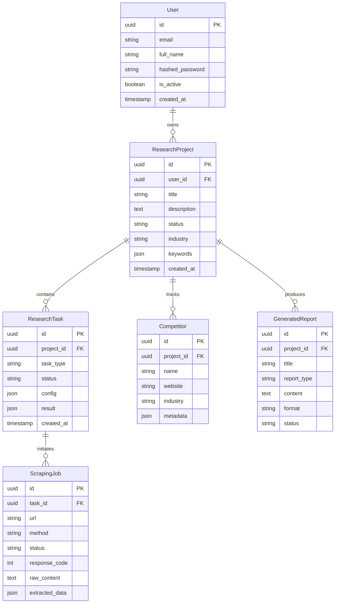

# System Architecture — MarketIntel AI

## 1. High-Level Architecture

MarketIntel AI is structured as a decoupled monorepo composed of a Next.js frontend client and an asynchronous FastAPI backend service, designed for high-throughput autonomous market research.

```
+-------------------------------------------------------------+
|                      Client Layer                           |
|      Next.js 16 (App Router) + Tailwind CSS + Recharts     |
+-------------------------------------------------------------+
                              │ HTTP / REST / JSON
                              ▼
+-------------------------------------------------------------+
|                      Backend Gateway                        |
|        FastAPI + Pydantic v2 + Structured Middleware        |
+-------------------------------------------------------------+
        │                     │                     │
        ▼                     ▼                     ▼
+---------------+    +-----------------+   +------------------+
| Agent Engine  |    | Scraper Engine  |   | Persistence      |
|  (LangGraph)  |    | Playwright/HTTPX|   | PostgreSQL       |
| ResearchAgents|    | Dynamic Harvest |   | SQLAlchemy Async |
+---------------+    +-----------------+   +------------------+
```

---

## 2. Frontend Architecture (Next.js)

The frontend is built using Next.js App Router and React Server/Client Components.

- **`src/app/`**:
  - `page.tsx`: Executive dashboard displaying market signals, job counts, active projects, and system metrics.
  - `research/`: Research workspaces for defining analysis parameters and reviewing agent hypotheses.
  - `scraper/`: Web scraping execution center monitoring jobs, protocols (HTTPX vs. Playwright), status codes, and hashes.
  - `competitors/`: Competitor analysis matrix tracking target company profiles and intelligence vectors.
  - `market-intel/`: Trend intelligence charts and synthesis insights.
  - `reports/`: Document generator and exports (Markdown, HTML, Executive Briefs).
  - `settings/`: Workspace configuration, API endpoints, and display modes.
- **`src/components/layout/`**:
  - `sidebar.tsx`: Persistent navigation bar with dynamic path recognition and collapsible state.
  - `top-nav.tsx`: Global search, workspace breadcrumb, and notifications.
  - `app-layout.tsx`: Standard unified layout providing consistent responsive styling.
- **`src/components/ui/`**: Modular, accessible atomic components (`button`, `card`, `badge`, `input`, `loading`, `empty-state`).
- **`src/services/`**: Centralized HTTP client (`api.ts`) managing error mapping and authentication propagation.

---

## 3. Backend Architecture (FastAPI & SQLAlchemy)

The backend employs a layered modular architecture prioritizing clean separation of concerns:

1. **API Layer (`app/api/`)**:
   - Router registration with semantic versioning (`/api/v1`).
   - Standardized endpoint responses through Pydantic models.
   - Global exception translation (`HTTPException`, `ValidationError`, generic failures).
2. **Core Layer (`app/core/`)**:
   - Central configuration management with `pydantic-settings` reading from `.env`.
   - Structured logging with correlation IDs (`X-Request-ID`).
   - CORS origin validation and middleware pipelines.
3. **Database Layer (`app/database/` & `app/models/`)**:
   - Asynchronous engine and session factory with connection pooling (`asyncpg`).
   - Universal base model with automatic table naming and timestamp tracking (`TimestampMixin`).
   - Relational entities with cascading deletes and relationship maps.
4. **Agent & Scraping Subsystems (`app/agents/`, `app/scraper/`)**:
   - Orchestration workflows powered by LangGraph state machines.
   - Extraction pipelines handling rate limiting, DOM sanitization, and structured parsing.

---

## 4. Data Models & Entity Relationships



---

## 5. Security & Reliability

- **No Secret Leaks**: Configuration is strictly injected via environment variables.
- **Fail-Safe Startup**: Application initializes gracefully even when external datastores are warming up; health check `/api/v1/health/ready` surfaces degraded state transparently.
- **Async Execution**: I/O tasks are offloaded to asynchronous coroutines to prevent thread starvation under heavy concurrent scraping tasks.

